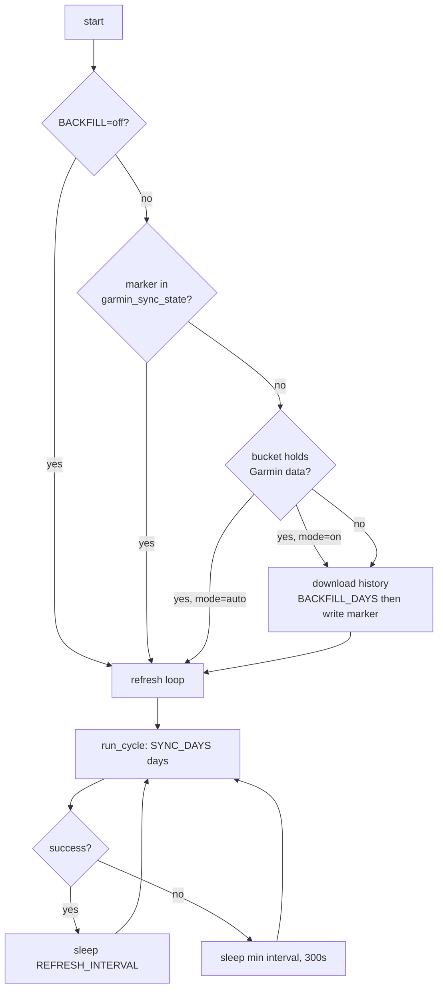

# Architecture

Current state: **v0.1.1** (see [CHANGELOG](../CHANGELOG.md)). This document
describes how the bridge is built, where each responsibility lives, and how a
single run flows from Garmin to InfluxDB.

## Purpose

Pull health metrics from the Garmin Connect **Personal API** and store them in
InfluxDB 2.x so Grafana can chart them. One Garmin account per bucket; the
service is stateless apart from the bearer-token cache and the backfill marker.

## Layout

```text
.
├── Dockerfile               image build (python:3.12-slim, non-root UID 1000)
├── compose.yaml             standalone service definition
├── pyproject.toml           dependencies, console script, version
├── src/
│   ├── cli.py               argument parsing and exit codes
│   ├── config.py            Settings from environment, duration parsing
│   ├── util.py              logging setup, one-line error rendering
│   ├── version.py           distribution version from package metadata
│   ├── garmin/
│   │   ├── connection.py    authenticated Personal API sessions
│   │   └── points.py        payload → InfluxDB Point conversion
│   ├── influx/
│   │   ├── connection.py    InfluxDB 2.x session + write API
│   │   └── writer.py        per-dataset sync functions, request pacing
│   └── service/
│       ├── backfill.py      first-sync detection, history download, marker
│       └── schedule.py      refresh interval, retries, service loop
├── tests/                   unittest suite (no network, no credentials)
├── dashboards/              importable Body Ops dashboard (JSON)
└── docs/                    this document, endpoint inventory, panel audits
```

`src/` is the import root: `garmin`, `influx` and `service` are packages,
`cli`, `config`, `util` and `version` are top-level modules
(`[tool.setuptools] package-dir = {"" = "src"}`).

Responsibilities are separated by direction of data flow: **garmin/** reads,
**influx/** writes, **service/** decides when.

## Runtime flow



### Startup: first-sync detection

`maybe_backfill()` answers one question — *has this bucket ever been
backfilled?* — with two cheap Flux probes:

1. `garmin_sync_state.backfill_completed` present → a backfill already ran.
2. Otherwise, any record in `garmin_daily_summary`, `garmin_steps` or
   `garmin_sleep` → the bucket already holds Garmin history (for example a
   bucket filled by hand or by an older release).

| `BACKFILL` | marker | bucket has data | result |
| --- | --- | --- | --- |
| `off` | — | — | never backfill |
| `auto` (default) | yes | — | skip |
| `auto` | no | yes | skip, keep existing history |
| `auto` | no | no | **download `BACKFILL_DAYS` days, write marker** |
| `on` | yes | — | skip |
| `on` | no | yes | **download `BACKFILL_DAYS` days, write marker** |
| `on` | no | no | **download `BACKFILL_DAYS` days, write marker** |

Consequences:

- **A fresh install with an empty bucket backfills by itself.** No manual
  command, no env change.
- **Restarting is free.** The marker makes `auto`/`on` a no-op on every later
  start, so enabling backfill twice never re-downloads a year.
- **Overwrites, not duplicates.** Every point has a deterministic timestamp
  (local midnight for daily points, the sample time for heart rate, the start
  time for activities), so a re-run is idempotent by construction.
- **An explicit run always wins.** `garmin-influx-sync --backfill DAYS` ignores
  the marker (useful after widening `BACKFILL_HR_DAYS`) and writes it again when
  it succeeds.

If the probe itself fails (InfluxDB down at boot), the error is logged and the
refresh loop starts anyway; the next restart retries the detection.

### Steady state: refresh

`run_cycle()` re-reads the last `SYNC_DAYS` days (1..31) and rewrites them.
The window is also widened to cover at least `REFRESH_INTERVAL` plus a
three-hour overlap before the current time. `SYNC_DAYS` remains the floor, so
the default (three days) is unchanged; with a short `SYNC_DAYS`, a late cycle
still re-reads the previous day instead of skipping the midnight boundary.
`REFRESH_INTERVAL` accepts `6h`, `12h`, `1d`, `90m` or plain seconds; the
default is `6h` and the minimum 15 minutes. A failed cycle (any heart-rate day
failed) is retried after `min(REFRESH_INTERVAL, 300s)` instead of waiting the
full interval — a slow InfluxDB start does not cost six hours.

Range metrics (HRV, steps, sleep, daily summaries, activities) are fetched in
chunks of 28 or 90 days, with 0.6 s between requests. Heart rate is one request
per day, with 0.4 s between days. A failing dataset is logged and does not stop
the others; only heart-rate failures make the cycle fail.

## Measurements

| Measurement | Fields | Timestamp | Idempotency key |
| --- | --- | --- | --- |
| `garmin_hrv` | `last_night_avg_ms`, `weekly_avg_ms`, `last_night_5min_high_ms` | local midnight | day |
| `garmin_daily_hr` | `resting_bpm`, `min_bpm`, `max_bpm` | local midnight | day |
| `garmin_heart_rate` | `bpm` | sample time (UTC) | sample time |
| `garmin_steps` | `steps`, `step_goal` | local midnight | day |
| `garmin_sleep` | `sleep_seconds`, `deep_seconds`, `light_seconds`, `rem_seconds`, `awake_seconds`, `sleep_score`, `bedtime_local_ms`, `wake_local_ms`, … | local midnight of the wake date | day |
| `garmin_daily_summary` | `calories_active`, `calories_resting`, `heart_rate_resting`, `intensity_moderate`, `intensity_vigorous`, `stress_avg`, `body_battery_latest`, `spo2_avg`, … | local midnight | day |
| `garmin_activity` | `duration_seconds`, `distance_m`, `calories`, `average_hr`, `max_hr`, `steps`; tag `activity_type` | activity start (UTC) | start time + type |
| `garmin_sync_state` | `backfill_completed`, `backfill_days` | completion time (UTC) | one point per backfill |

Daily points are stamped at midnight in `TZ`, so Grafana shows them on the
right calendar day. `garmin_activity` is the only tagged measurement; adding
more tags would multiply series for no benefit in a single-account bucket.

## Failure model

| Failure | Behaviour |
| --- | --- |
| Garmin `429` | the day/chunk is logged and skipped; the rest of the run continues |
| Garmin `401`/`403` | error logged; delete the `garmin_auth` volume to force a new bearer token |
| InfluxDB unavailable | the whole cycle fails and is retried after 5 minutes |
| Backfill interrupted | no marker is written, so the next start retries; already-written days are overwritten |
| One dataset down | logged; the other datasets still sync |

Logs contain dates, point counts and error types/status codes only. Parsed
metric values are never logged, and API error bodies are truncated.

## Configuration

| Variable | Default | Meaning |
| --- | --- | --- |
| `GARMIN_PERSONAL_API_KEY` | — (required) | Personal API key |
| `INFLUX_TOKEN` | — (required) | write token |
| `INFLUX_URL` | `http://influxdb:8086` | InfluxDB base URL |
| `INFLUX_ORG` | `homelab` | organization |
| `INFLUX_BUCKET` | `garmin` | destination bucket |
| `SYNC_DAYS` | `3` | days refreshed per cycle (1..31) |
| `REFRESH_INTERVAL` | `6h` | delay between cycles, ≥ 15m (`6h`, `12h`, `1d`, seconds) |
| `BACKFILL` | `auto` | `auto`, `on` or `off` |
| `BACKFILL_DAYS` | `365` | history depth for range metrics (1..365) |
| `BACKFILL_HR_DAYS` | `30` | heart-rate sample days in a backfill (1..365) |
| `TZ` | `Europe/Paris` | IANA zone for daily points and report windows |

## Design rules

- **Never invent data.** Missing or reshaped fields are skipped with a warning;
  no defaults are written.
- **Deterministic timestamps.** That is what makes every write idempotent.
- **Pacing is explicit.** Garmin rate limits are the binding constraint, so
  delays live next to the loops that need them.
- **One account per bucket.** No measurement is keyed by user.
- **Secrets stay out of the image.** The API key comes from `env_file`; the
  bearer token is cached in the `garmin_auth` volume, never in Git.

## Known limits

- FIT files, food logs, lifting sets, hydration, weight, body battery
  timelines, daylight/sound/wrist temperature are reachable through the API but
  not ingested yet — see [garmin-endpoints.md](garmin-endpoints.md).
- Heart-rate samples are only backfilled for `BACKFILL_HR_DAYS`, by design:
  it costs one request per day, and Garmin returns `heartRateValues` for only
  about the last 150 days. Older dates keep `garmin_daily_hr` but add no sample
  points, so a deeper backfill does not extend the year-long heatmap.
- Activities are paged at 20 per request, 50 pages maximum per backfill.
- A failed backfill day is not retried automatically once the marker is
  written; rerun `--backfill` for that.
